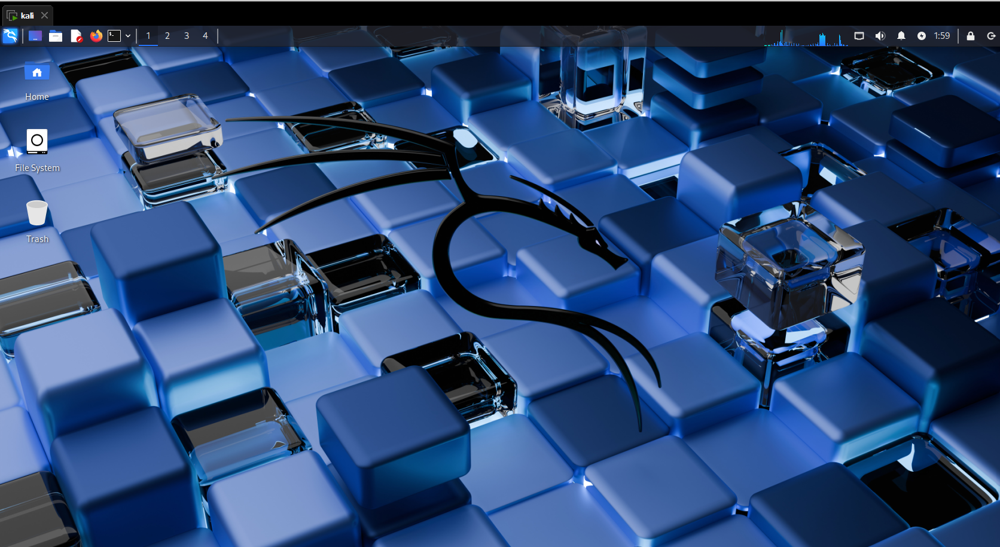
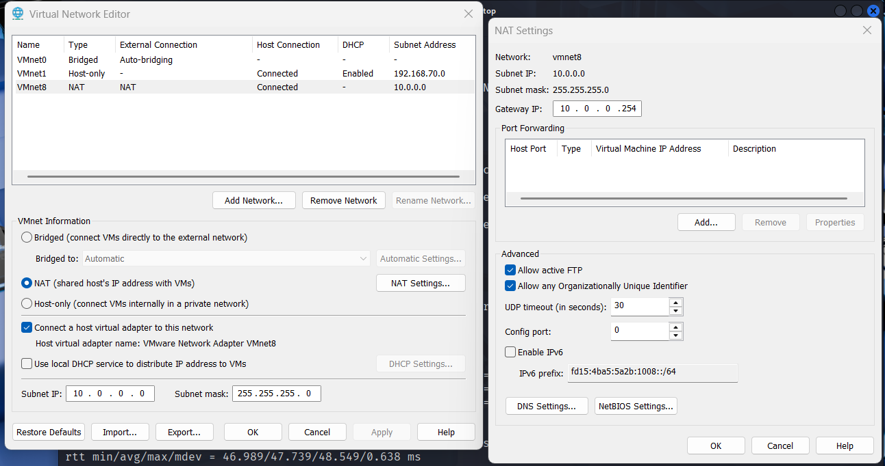
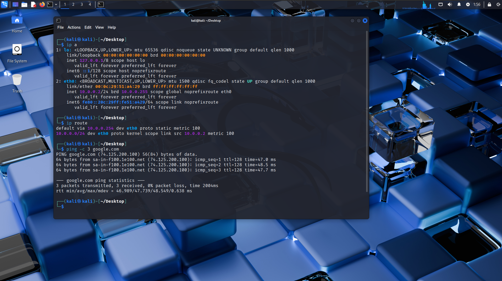
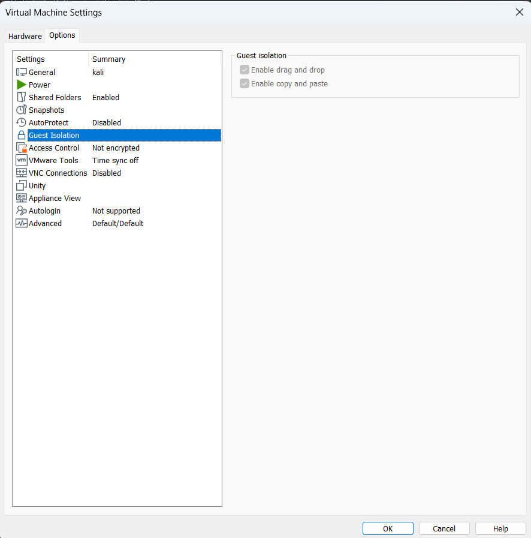
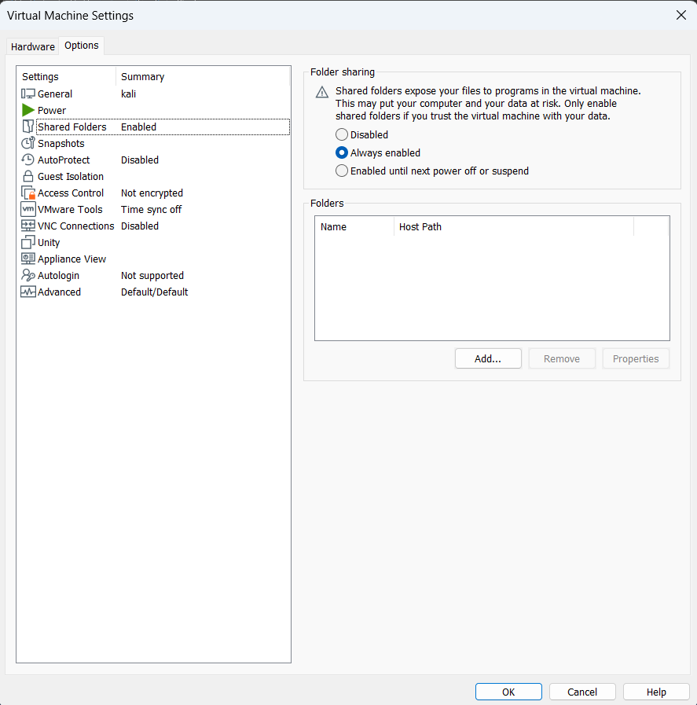
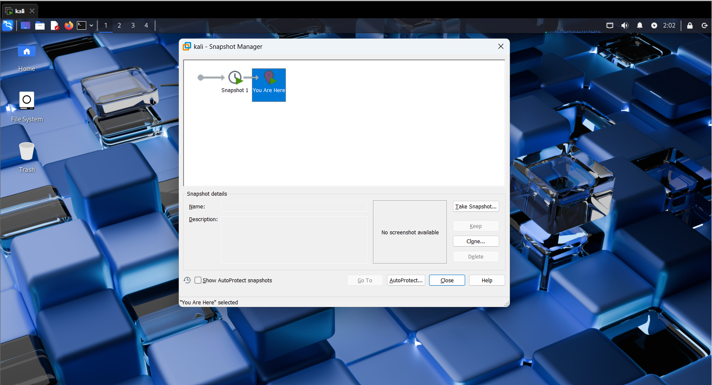

# 🔐 Cybersecurity Lab Environment Setup

**Building an isolated virtual lab for penetration testing and ethical hacking practice using VMware and Kali Linux**

          

---

## 📌 Project Overview

This is my **Week 1 – Project Module 1 (WK1-PM1)** submission for the Networkwalks Cybersecurity Internship, Batch **B084**.

The project builds a **safe, isolated cybersecurity lab** on my own computer. A Kali Linux virtual machine runs on a private virtual network, so I can practise security tools without touching any real system.

> **Note:** VirtualBox is the recommended hypervisor for this project, but it is not supported on my machine. I used **VMware Workstation** instead, which the project guide allows as an alternative. All project requirements are met; only the network configuration steps differ.

---

## 🎯 Objectives

- Install VMware Workstation as the virtualization platform.
- Import the latest Kali Linux as a virtual machine.
- Create a private NAT network using the `10.0.0.0/24` subnet.
- Assign the fixed IP address `10.0.0.2/24` to Kali Linux.
- Confirm that Kali Linux has full internet access.
- Enable clipboard sharing and drag-and-drop between host and VM.
- Share the host Downloads folder with the VM.
- Take a clean snapshot for recovery.
- Document the full process with screenshots.

---

## 🛡️ Purpose of the Lab

The lab gives me a controlled place to learn and practise, for example:

- Network scanning and reconnaissance
- Vulnerability assessment
- Traffic and packet analysis
- Web application testing
- Learning how security tools behave

⚠️ **Important:** Use this lab only on systems I own or have written permission to test. Never use these tools against real, unauthorized targets.

---

## 🏗️ Lab Architecture

```
            Internet
               |
   Host PC (Windows 11) - VMware NAT service
               |
     VMnet8 (NAT)  10.0.0.0/24
     Gateway: 10.0.0.254
               |
     Kali Linux VM  10.0.0.2/24
```



More virtual machines can be added to the same network in future projects.

---

## ⚙️ Lab Configuration

| 🧩 Component | ⚙️ Configuration |
|---|---|
| 🖥️ Host OS | Windows 11 Home |
| 🧰 Hypervisor | VMware Workstation 17 Pro (17.0.2) |
| 🐉 Guest OS | Kali Linux 2025.1 |
| 🌐 Virtual Network | VMnet8 (NAT) |
| 📡 Network Address | 10.0.0.0/24 |
| 🐧 Kali IP Address | 10.0.0.2/24 (static) |
| 🚪 Default Gateway | 10.0.0.254 |
| 🌍 DNS Server | 8.8.8.8 |
| 🔌 VMware DHCP | Disabled |
| 🔮 Planned VM Range | 10.0.0.2 – 10.0.0.99 |

---

# 🪜 Lab Setup Procedure

## Step 1. Install 7-Zip

7-Zip was installed to extract the Kali Linux VM image, which is downloaded as a compressed archive.

## Step 2. Install VMware Workstation

VMware Workstation 17 Pro was installed on Windows 11 as the hypervisor.

## Step 3. Configure the 10.0.0.0/24 network

In **Edit > Virtual Network Editor > Change Settings**, the **VMnet8 (NAT)** network was configured:

- Subnet IP: `10.0.0.0`
- Subnet mask: `255.255.255.0`
- Local DHCP service: **disabled**, so VMware does not hand out addresses
- NAT gateway: changed from `10.0.0.2` to `10.0.0.254`

The gateway was moved because VMware uses `x.x.x.2` as the gateway by default, which would clash with the required Kali IP `10.0.0.2`.




## Step 4. Import Kali Linux

The Kali Linux VMware image was downloaded from the official Kali website, extracted with 7-Zip, and opened in VMware. The VM network adapter is set to **NAT**, which connects it to VMnet8.

## Step 5. Configure the static IP in Kali Linux

```bash
sudo nmcli connection modify "Wired connection 1" ipv4.method manual ipv4.addresses 10.0.0.2/24 ipv4.gateway 10.0.0.254 ipv4.dns 8.8.8.8
sudo nmcli connection down "Wired connection 1"
sudo nmcli connection up "Wired connection 1"
```

> **Important:** The connection name may be different on other systems. Run `nmcli connection show` first to find yours.



## Step 6. Enable clipboard and drag-and-drop

In **VM > Settings > Options > Guest Isolation**, both **Enable drag and drop** and **Enable copy and paste** were turned on.



## Step 7. Share the Downloads folder

In **VM > Settings > Options > Shared Folders**, sharing was set to **Always enabled** and the host **Downloads** folder was added. Inside Kali, the shared folder appears under `/mnt/hgfs/`.



## Step 8. Take a clean snapshot

After everything was working, a snapshot was taken with **VM > Snapshot > Take Snapshot**. It is a clean baseline that I can restore if a future exercise breaks the VM.



---

# 🔎 Lab Verification

| ✅ Test | 🧾 Command / Action | 🎯 Result |
|---|---|---|
| 🌐 IP address | `ip a` | `10.0.0.2/24`, static (no "dynamic" flag) |
| 🚪 Routing | `ip route` | Default route via `10.0.0.254` |
| 🌍 Internet and DNS | `ping -c 3 google.com` | 3 of 3 replies, 0% packet loss |
| 📁 Shared folder | `ls /mnt/hgfs/` | Downloads folder is listed |
| 📋 Clipboard | Copy on Windows, paste in Kali | Text pasted correctly |
| 💾 Snapshot | VM > Snapshot > Snapshot Manager | Snapshot is listed |

### Example Results

```
Kali IP address : 10.0.0.2/24 (static)
Default gateway : 10.0.0.254
Ping test       : 3 packets transmitted, 3 received, 0% packet loss
```

---

# 🐞 Problems Encountered & Solutions

## Problem 1. Kali received a dynamic IP address instead of 10.0.0.2

After the first boot, Kali showed `10.0.0.128/24` marked as **dynamic**, and the default route pointed to `10.0.0.2`. Even after changing the VMware settings, the old address stayed.


**Cause:**

- VMware's DHCP service was giving Kali an address from its default range.
- VMware's NAT gateway was using `10.0.0.2`, the exact address required for Kali. Two devices cannot share one IP.
- Kali was still holding its old DHCP lease.

**Solution:**

1. Moved the VMware NAT gateway to `10.0.0.254`.
2. Disabled the VMware DHCP service on VMnet8.
3. Set the IP address manually in Kali with `nmcli` (Step 5).
4. Verified with `ip a`, `ip route`, and `ping`.

**Result:** Kali now uses the static IP `10.0.0.2/24` and has full internet access.

---

# 💡 What I Learned

### 1. NAT networking in VMware
I learned how VMnet8, the NAT gateway, and the DHCP service work together, and how to customize them for a lab subnet.

### 2. IP address planning
Two devices cannot use the same IP address. Checking the default gateway before choosing a static IP avoids conflicts.

### 3. Static IP configuration in Linux
I learned to set and verify an IP address, gateway, and DNS server using `nmcli`, `ip a`, `ip route`, and `ping`.

### 4. Snapshots
A clean snapshot gives me a safe recovery point before I experiment with security tools.

### 5. Documentation
Writing down commands, screenshots, problems, and fixes is an important part of professional cybersecurity work.

---

# 🔐 Security & Ethical Use

This lab is for **education and learning only**. All work was done inside my own virtual environment on a device I own. I will only test systems that I own or have written permission to test.

---

# 🔗 Tools & Resources

- **7-Zip:** https://7-zip.org/download.html
- **Kali Linux:** https://kali.org/get-kali
- **VMware Workstation:** downloaded from the official VMware website

---

# 👤 Author

**Mubassir**
Cybersecurity Intern, Networkwalks (Batch B084)
Instructor: Waqas Karim CCIE

---

## 📌 Project Information

**Program Name:** Cybersecurity at Networkwalks | **Week:** 01 | **Project:** Cybersecurity & Pentesting Lab Setup | **Repository:** GitHub
